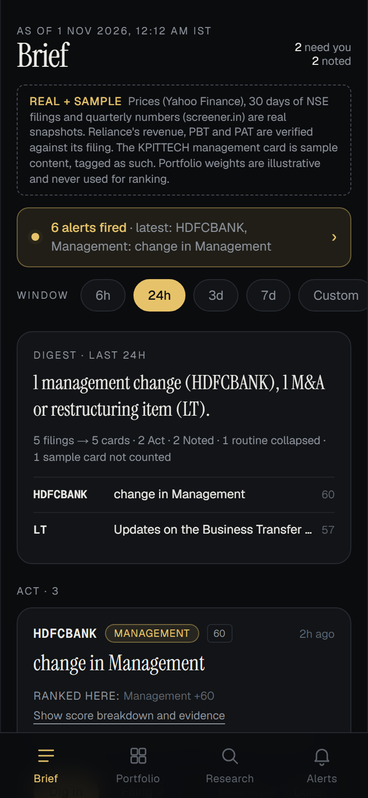
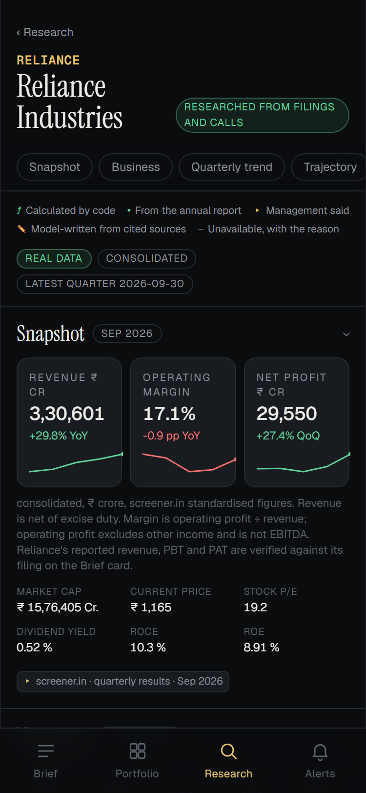
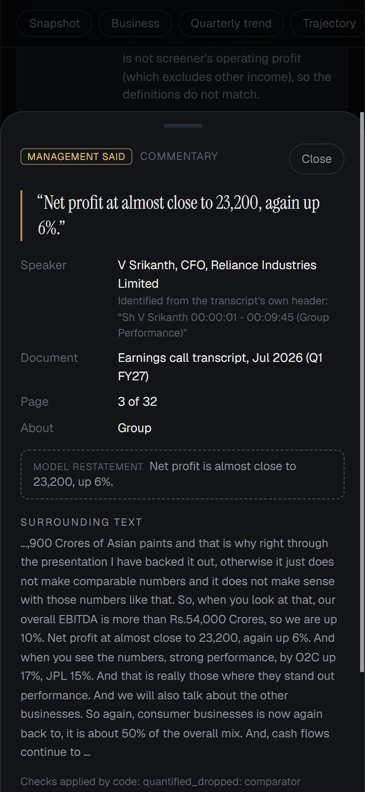

# FINN

**Investment intelligence for a public-markets investor: what changed, and why it matters.**

FINN is a mobile-first web app with two halves. **Push** turns exchange filings and unusual price and volume moves into a ranked, explainable daily briefing. **Pull** produces on-demand research from primary sources only (annual report, concall transcripts, standardised financials), with a citation (document, page, verbatim quote) behind every claim.

Live app: <https://enam-finn.vercel.app/>

| Brief | Research dossier | Citation |
|---|---|---|
|  |  |  |

*Screenshots of the deployed application, captured 2 November 2026 (375 px mobile viewport).*

## What it does

**Push**
- A digest over a selectable window (6h, 24h, 3d, 7d, custom, or unseen), tiered **Act / Noted / Routine**. Routine paperwork collapses into one row.
- Every card has an itemised, deterministic score with its evidence and source links. No model is involved and nothing interprets a filing: FINN states what arrived and how large a change is.
- Related filings group only on strong evidence (same attachment, specific subject, near-identical text, same stated period), and every original stays reachable.
- Results cards show Revenue, Operating profit, PBT and PAT with QoQ and YoY changes. Unusual price and volume moves are measured against each stock's own history.
- Alerts with configurable volume-multiple and %-move thresholds and announcement categories, saved on the device.

**Pull** (full cited dossier for RELIANCE)
- Business snapshot, financial trajectory, balance sheet, cash quality, and promised versus delivered.
- Forward-looking management statements with speaker, designation and page, and a bull/bear case labelled **model-written**.
- Metrics and guidance verdicts are calculated in code, and a verdict is issued only when definition, period and basis match; otherwise FINN says why it did not compare.
- Four kinds of content stay visibly distinct: calculated metrics, extracted facts, management statements, and model synthesis.

## How it is built

```
Ingest scripts ──► committed JSON snapshots (data/) ──► Next.js server components ──► mobile UI
Research pipeline (offline, Gemini) ──► data/research/<SYM>/dossier.json ───────────┘
```

- **Snapshot-first.** Prices, announcements, fundamentals and the research dossier are ingested ahead of time and committed. The deployed app needs no environment variables and makes no upstream or model calls.
- **The model proposes, code disposes.** Gemini extracts candidate facts; code verifies every quote against its page, takes speakers from transcript headers, re-derives comparators, units and periods, computes all numbers, and discards unsupported synthesis.
- **Honest data.** Sample, real and unavailable data are labelled. Operating profit is never called EBITDA. Unavailable values are shown as unavailable with the reason.

Stack: Next.js 16 (App Router), React 19, TypeScript (strict), Tailwind CSS 4, framer-motion, zod, cheerio, unpdf, vitest.

## Data sources

| Data | Source |
|---|---|
| End-of-day prices and volume | Yahoo Finance chart endpoint (`.NS`) |
| Exchange announcements | NSE corporate-announcements API (BSE's API was blocked and is not used) |
| Quarterly and annual financials, document links | screener.in |
| Filing PDFs, annual report, concall transcripts | NSE and BSE-hosted documents linked from the above |
| Research model | Google Gemini (`gemini-3.5-flash-lite` for extraction, `gemini-3.5-flash` for synthesis) |

Data is a snapshot as of 30 October 2026. Portfolio weights are illustrative. This is not investment advice.

## Getting started

Requires Node.js 20.9 or later.

```bash
npm install
npm run dev
```

Open <http://localhost:3000>. No configuration is needed to run the app.

| Command | Purpose |
|---|---|
| `npm run build` / `npm start` | Production build and server |
| `npm test` | 292 tests across 18 suites |
| `npm run lint` / `npm run typecheck` | Static checks |
| `npm run validate` | Validate the committed data snapshots |
| `npm run ingest [-- --sym X --only prices\|ann\|fund --refresh]` | Re-fetch prices, announcements and fundamentals |
| `npm run enrich` | Read page 1 of ambiguous filing attachments and re-classify |
| `npm run research:extract`, `research:reverify`, `research:build` | Run the RELIANCE research pipeline (needs `GEMINI_API_KEY`) |

To run the research pipeline, copy `.env.example` to `.env.local` and set `GEMINI_API_KEY`. Keep the key out of version control; a test fails if it appears in any tracked file.

## Deployment

Deployed on Vercel with the default Next.js settings and no environment variables. `next.config.ts` traces only the committed runtime data for `/research/[sym]` and excludes raw downloads.

## Project layout

```
app/          routes and the /api/health handler
components/   mobile UI; components/research/ for the dossier and citation sheet
lib/data/     snapshot loaders, classification, grouping, scoring, digest, results, validation
lib/research/ transcript parsing, extraction, verification, metrics, guidance, synthesis
lib/sources/  Yahoo, NSE, screener.in and PDF adapters
scripts/      ingest, enrich, validate, research pipeline
data/         committed snapshots (prices, announcements, fundamentals, research)
docs/         methodology, verification and measurements
tests/        vitest suites and fixtures
```

## Documentation

| Document | Contents |
|---|---|
| [`IMPLEMENTATION_PLAN.md`](IMPLEMENTATION_PLAN.md) | Architecture, decisions, status and trade-offs |
| [`docs/PUSH_INTELLIGENCE.md`](docs/PUSH_INTELLIGENCE.md) | Classification, grouping and the exact scoring weights |
| [`docs/RESEARCH_PIPELINE.md`](docs/RESEARCH_PIPELINE.md) | The research pipeline, usage and coverage |
| [`docs/RESEARCH_VERIFICATION.md`](docs/RESEARCH_VERIFICATION.md) | How research output was verified, and known gaps |
| [`docs/RESEARCH_PILOT.md`](docs/RESEARCH_PILOT.md) | Model access, token calibration and the pilot extraction |
| [`docs/DATA_SPIKE.md`](docs/DATA_SPIKE.md), [`docs/DATA_COVERAGE.md`](docs/DATA_COVERAGE.md), [`docs/DATA_VERIFICATION.md`](docs/DATA_VERIFICATION.md) | Source feasibility, coverage, and verification against the original filing |
| [`docs/AI_BUILD_HISTORY.md`](docs/AI_BUILD_HISTORY.md) | An engineering account of building FINN with an AI coding assistant |

## Limitations

- Research is complete for RELIANCE only. Other tickers show real numeric sections and labelled "not yet researched" sections; there is no arbitrary-ticker research API.
- Of 42 RELIANCE guidance items, 1 could be tested against a calculated metric; the rest are explicitly "not compared" or "not measurable", because growth basis is often unstated and definitions differ.
- Reported figures are filing-verified for RELIANCE only. Other companies use screener.in figures under labels that say so.
- The October 2026 RELIANCE transcript is unavailable; 36 of 187 annual-report pages were read.
- The management-change bio is a labelled sample; there is no grounded Q&A, PWA manifest or real push notification.
- Some research-UI labels still show raw schema wording (for example "pat amount").
