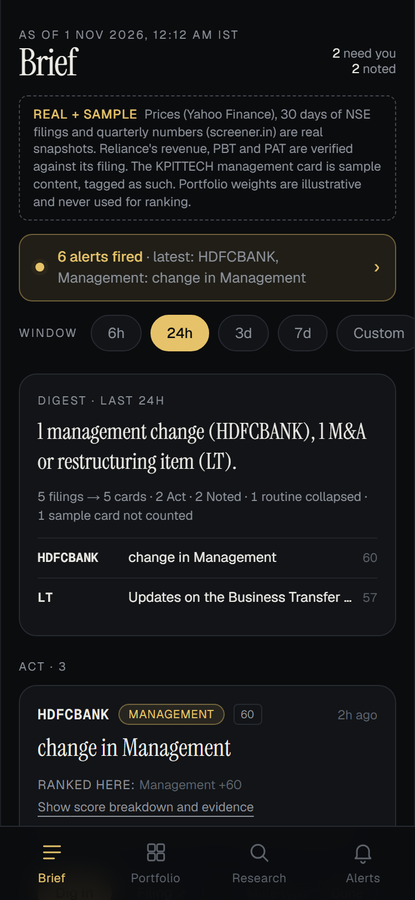
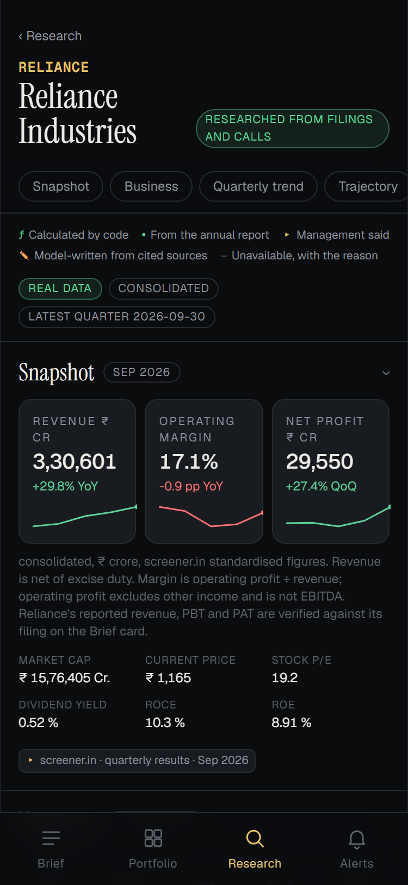
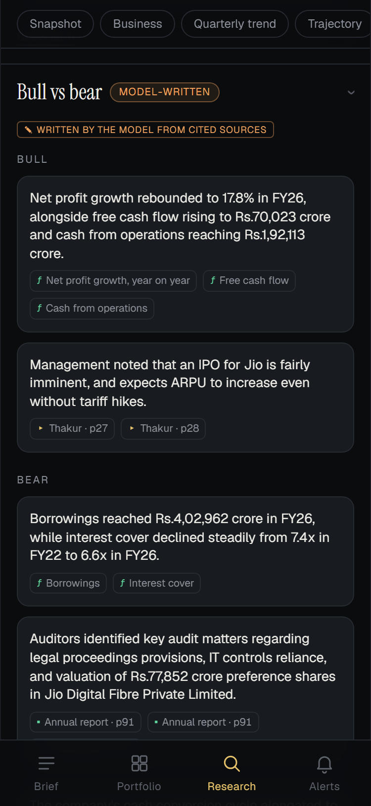
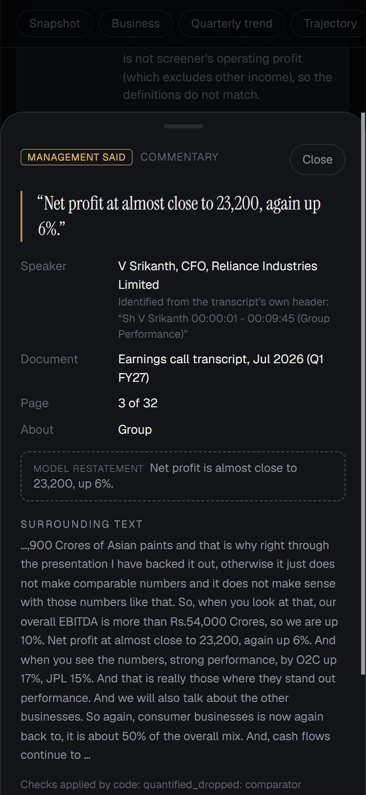

# FINN — AI Build History

ENAM Holdings AI Engineer Build Challenge · Live app: <https://enam-finn.vercel.app/> · Repo: `github.com/AravindSarath/ENAM-FINN` (`master`)

**Evidence base.** The Claude Desktop Code transcript (one session, 31 Oct 2026 20:32 IST onward), the six Git commits, `CLAUDE.md`, `IMPLEMENTATION_PLAN.md`, `docs/` and the committed data. Quotations are copied from the transcript. The owner's prompts appear as they were pasted into the session; the transcript cannot show whether they were drafted elsewhere. Times are IST. Anything only discussed is marked *not built*.

**Roles.** *Owner*: scope, definitions, gates and approvals. *Claude*: Claude Code, which planned, implemented, debugged, tested and documented. *Gemini*: the model called by the Stage 4 research pipeline. The owner told Claude to "Make the technical decisions yourself", so architecture and code are mostly Claude's; the owner's contribution is direction, gating, definitions and review.

## 1. Outcome

| Item | Result |
|---|---|
| Product | Mobile-first Push (Brief, Portfolio, Alerts) and Pull (Research) app: Next.js 16, React 19, TypeScript, Tailwind 4 |
| Data | 22 tickers (18 portfolio, 4 research); Yahoo prices (126 daily bars each), NSE announcements, screener.in tables (21 tickers fully covered, 1 partial), committed as JSON snapshots |
| Research | RELIANCE only: 3 concall transcripts and 36 selected annual-report pages → 138 verified facts, 29 computed metrics, 42 guidance items, model-written bull/bear |
| Checks | 292 tests in 18 files, snapshot validator (0 errors, 0 warnings), lint, typecheck, production build |
| Live (owner-verified) | Homepage loads; `/api/health` returns `{"ok":true,"app":"finn","time":"<runtime timestamp>"}`; `/research/RELIANCE` shows research sections, financial metrics and source references. The mobile layout was inspected; no physical-phone test is claimed |

| Commit | IST | Message |
|---|---|---|
| `0d3bb2e` | 31 Oct 20:56 | chore: complete Stage 0 project foundation |
| `a13fc4d` | 31 Oct 21:05 | feat: Stage 1 mobile-first frontend on mock data |
| `402d5a1` | 31 Oct 21:34 | feat: Stage 2 data integration for 22 tickers |
| `b0a158c` | 31 Oct 22:25 | feat: Stage 3 push intelligence |
| `5ca7ea0` | 1 Nov 02:54 | feat: Stage 4 RELIANCE research dossier |
| `ada66f8` | 1 Nov 03:26 | chore: prepare Vercel deployment |

## 2. Working method

Each stage followed one loop: the owner states a stage and its constraints, Claude plans or implements and reports, the owner approves, the next stage starts. The gates are explicit in the prompts: "Do not start Stage 1 yet", "Wait for my approval before expanding to other companies", "Stop after calibration and wait for my approval before real document extraction", "Do not deploy yet". Claude used the terminal and file tools to scaffold, ingest, test, build and commit; the in-app browser pane to check pages at 375px; and, in Stage 4, the Gemini REST API. Every stage closed with lint, typecheck, tests, the validator and a production build before its commit, as each owner prompt required.

## 3. Chronology

**Plan (no commit).** First prompt: "I want a premium, mobile-first investment intelligence product, not a generic chatbot or dashboard. Make the technical decisions yourself. Prioritise a working prototype over feature completeness." Claude read both PDFs and wrote `CLAUDE.md` and `IMPLEMENTATION_PLAN.md`: a briefing you triage with research behind every card; four tabs; committed snapshots so the demo never depends on live APIs; numbers computed in code; uncited claims dropped in code. Nothing had been run.

**Stage 0, spike and scaffold (`0d3bb2e`).** Claude tested every source before building on it. BSE failed: "Both endpoints returned 403 Access Denied, so I dropped BSE." NSE worked without cookies. screener.in worked but returned 429 on 4 of 14 tickers at about one request per second, so ingestion was slowed to 4–5 s spacing and cached. screener has no EBITDA row, so Operating Profit is used and labelled. The plan's initial "BSE primary" choice was reversed by this evidence (`docs/DATA_SPIKE.md`).

**Stage 1, frontend on labelled mock data (`a13fc4d`).** Four-tab shell: Brief, Portfolio, Research, Alerts. The owner's only message was "Commit."

**Stage 2, data integration (`402d5a1`).** RELIANCE end-to-end first, as the owner required, with Claude comparing the results-filing PDF to screener (section 4). Then all 22 tickers were ingested with no source failures: 21 fully covered and 1 partially covered (TATAELXSI, which uses a standalone fallback because screener's consolidated series stops at 2015). Other gaps are recorded, not hidden: HAL, ITC and TITAN have no Sep-quarter results; banks have no Operating Profit row and show "n/a" with a reason. 129 tests (`docs/DATA_COVERAGE.md`, `docs/DATA_VERIFICATION.md`).

**Stage 3, push intelligence (`b0a158c`).** Deterministic 0–100 materiality scores with itemised reasons (Act ≥ 55, Noted ≥ 30); evidence-based classification; grouping only on strong evidence; results cards; unusual price/volume alerts; configurable digest windows. Page-1 excerpts of 60 NSE filing PDFs were read with 0 failures. Unclassified, non-routine filings fell from 44 to 9. No Gemini was used; classification is rules plus PDF excerpts. 200 tests (`docs/PUSH_INTELLIGENCE.md`).

**Stage 4, RELIANCE research (`5ca7ea0`).** Key and model check → token calibration → one pilot extraction → owner review → bulk extraction → deterministic metrics → guidance checks → synthesis last → independent verification (sections 5–6; `docs/RESEARCH_*.md`).

**Deployment (`ada66f8`, then the owner).** Claude added `outputFileTracingIncludes`/`Excludes` and a Node `engines` field, then ran the production server with `data/raw/` and `.env.local` moved away: `/api/health`, `/research/RELIANCE`, `/research/DMART`, `/` and the other routes returned 200. The owner then pushed to GitHub and deployed on Vercel. Claude did not log in to either service.

## 4. Owner decisions and review

- **Definitions overrode Claude's recommendation.** Claude's recommendation:
  > I recommend showing screener's figure labelled "Revenue (net of excise duty)".

  The owner decided differently:
  > Use Revenue from Operations from the original filing as the primary Revenue metric.
  > Preserve Screener's ₹330,601 crore separately as "Revenue net of excise duty".

  PAT was likewise set as "total PAT including non-controlling interests", with owners' profit shown separately. This is why the schema and UI carry both definitions.
- **Verify, don't assume.** "Do not assume the earlier spike figures are correct without verification." And: "Relabel every remaining EBITDA reference to the correct metric; do not call Operating Profit EBITDA."
- **Scope control.** Stage 2 Step 1 limited to RELIANCE; Stage 4 "RELIANCE end-to-end first"; "Do not start Stage 5 or add more features."
- **Grouping.** "Do not merge filings solely because they share a symbol and category within 72 hours." Claude reported: "Stage 2 folded any repeated NSE label within 72 hours into one card, which you said not to do." Cards for the 257 portfolio filings rose from 205 to 233.
- **Approvals with limits.** Claude asked before downloading about 50 public NSE PDFs; the owner approved "including the public NSE PDF downloads" with limits on concurrency and storage, and "Failed extraction must never cause a filing to be classified as Routine."
- **Research rules.** Ten modifications, including "Every management statement must identify the speaker and source page. Analyst questions must never be attributed to management." and "Guidance verdicts must be calculated in code, with definition mismatches explicitly identified."
- **Spend discipline.** Calibration with tiny probes, then one pilot, then bulk, with "Do not expose the API key in output, logs, URLs or files."
- **Pilot review.** The owner directed:
  > Preserve exact comparison operators and qualifiers such as "more than", "at least", "approximately" and "up to".

  with "Never infer or repair a management statement's numerical meaning."
- **Deployment.** "Do not add Gemini API keys or other secrets to deployment configuration"; "Do not attempt GitHub or Vercel login yourself."

## 5. Claude's implementation and self-found corrections

Claude found and fixed these (transcript; fixes in `5ca7ea0` or earlier).

- **Model access.**
  > Both 2.5 models are unavailable to this key. `gemini-2.5-flash-lite` and `gemini-2.5-flash` returned 404 "no longer available to new users", even though the model list shows them.

  Claude switched to `gemini-3.5-flash-lite` and `gemini-3.5-flash`, which the owner's next prompt named. `gemini-3.8-flash` was slow and returned 503 and was not used. Default thinking truncated output, so `thinkingLevel: low` was adopted with the owner's approval.
- **Restatement errors found by reading all 32 pilot statements against the source.**
  > One restatement said "Rs. 1,17,000 Crores" where the speaker said "Rs.17,000 Crores", so the model changed the number.

  The model also added "EBITDA", "RCPL" and "RJIL" and used a company-wide margin metric for segment margins. Claude added guards so a restatement cannot add numbers or acronyms absent from its quote.
- **Recall gap.** "None come from the Q&A on pages 21–32." The model had stopped at its own item cap, so presentation and Q&A are now extracted in separate calls.
- **Comparator misapplication.**
  > Unfixed: one comparator is misapplied. "More than Rs.54,000 Crores, so we are up 10%" attaches "at least" to the 10% growth.

  After the owner's instruction, the comparator is derived in code from the words beside the number; any mismatch drops the structured claim and keeps the quote.
- **Synthesis v1** mixed periods (a quarter margin described as FY26) and added causal wording. Claude added period labels and checks for causal words, unsupported terms and rise/fall direction, then regenerated.
- **Smaller defects.** Regex backslashes corrupted by a heredoc (found by search, rewritten); count-based tests broken by re-ingest (now derived from data); metric tests that picked up the TTM column (pinned to March columns).

## 6. Gemini's role

Gemini is used only in Stage 4, offline. The deployed app makes no Gemini calls; it serves the committed dossier.

| Step | Model | Role |
|---|---|---|
| Extraction (10 persisted calls) | `gemini-3.5-flash-lite` | Proposes facts, quotes and structured claims from transcripts (presentation and Q&A separately) and annual-report topics |
| Synthesis (last) | `gemini-3.5-flash`, `thinkingLevel: low` | Business, bull and bear points, each citing fact or metric IDs |

Design principle (Claude's, owner-approved): the model proposes, code disposes. Code locates each quote on a page, takes the speaker from the transcript's own turn header, excludes analyst turns, re-derives comparator, unit, metric words and period from the quote, computes all metrics and guidance verdicts, and discards synthesis points whose citations, numbers, terms or periods are unsupported.

**Measured.** 160 facts proposed, 138 verified, 22 dropped (15 duplicates, 4 quote not found, 2 too long, 1 analyst turn). Every one of the 138 quotes was found on its cited page by a second PDF extractor (`pdftotext -raw`). The usage log holds 29 Gemini calls, including the pilot, re-runs and superseded syntheses: 24 on `gemini-3.5-flash-lite`, 5 on `gemini-3.5-flash`; 341,751 prompt tokens, 63,282 output tokens, 0 thinking tokens; three 503 "high demand" retries, all recovered; no 429. Calibration and model probes are documented in `docs/RESEARCH_PILOT.md` but are not in `usage.jsonl`.

## 7. Engineering trade-offs

- **Committed snapshots over live calls:** the demo cannot break on an upstream outage; the cost is staleness (data as of 30 Oct 2026).
- **Rules before LLM:** Push needs no model; research uses a cheap model for bulk work and a stronger one only for synthesis, within the free tier.
- **Numbers from code, labelled definitions:** Operating Profit is never called EBITDA (a test enforces it); unavailable data is shown as unavailable.
- **Vercel tracing:** only committed runtime data is traced for `/research/[sym]`; raw downloads are excluded (traced data files fell from 403 to 84).
- **RELIANCE only:** depth and verification over breadth, per the owner's scope gate.

## 8. Testing and verification

292 tests: dossier traceability and recomputation, synthesis revalidation, a secrets scan, the transcript parser, claim validation, scoring, grouping and data rules. The validator reports 0 errors and 0 warnings. A manual stratified sample of 12 facts and every synthesis point were read against sources (`docs/RESEARCH_VERIFICATION.md`). Browser checks at 375px showed no horizontal overflow and no console errors.

## 9. Final-submission screenshots

Captured on 2 Nov 2026 from the **deployed** app with headless Chrome emulating a 375×812 mobile viewport at 2× density. They are final-submission screenshots taken after deployment, not historical development screenshots, and not from a physical phone.

| File | Shows |
|---|---|
| `screenshots/01-brief.png` | Brief: data-labelling banner, alert strip, window chips, digest, first Act card |
| `screenshots/02-portfolio.png` | Portfolio heat map and sorted holdings; weights labelled illustrative |
| `screenshots/03-alerts.png` | Alert thresholds and category toggles |
| `screenshots/04-reliance-dossier-top.png` | RELIANCE header, source legend and snapshot (revenue labelled net of excise, operating profit "not EBITDA") |
| `screenshots/05-reliance-trajectory-business.png` | Five-quarter operating-margin chart and annual-report business snapshot with page citations |
| `screenshots/06-reliance-bull-vs-bear.png` | Model-written bull/bear points with cited metrics and pages |
| `screenshots/07-citation-source-view.png` | Citation sheet: quote, speaker from the transcript header, document, page 3 of 32, labelled model restatement |

   

## 10. Limitations

- Research covers RELIANCE only. Other tickers show real numbers with labelled placeholders; the arbitrary-ticker API is *not built*.
- The October 2026 transcript is unavailable (no link on screener.in). Only 36 of 187 annual-report pages were read; auditor (7) and contingent-liability (8) facts are thin; related-party facts were not extracted. Extraction recall is capped per call.
- Of 42 guidance items, 1 was tested (PAT ₹22,290 crore against Q3 FY26), 6 not compared and 35 not measurable: growth basis is often unstated, revenue and EBITDA definitions differ from screener's, and segment data is absent.
- Synthesis checks citations, numbers, terms, periods and direction, not full meaning; points are badged model-written. For 49 facts the model's restatement was withheld and only the quote is shown.
- Some research-UI labels show raw schema wording, for example "pat amount: 22290 crore" and "other: 36.3 other". This is cosmetic and was not corrected; screenshots showing it were left out of section 9.
- Results figures for companies other than RELIANCE are screener's, not filing-verified. Portfolio weights are illustrative. Real push notifications, auth and intraday data are out of scope. Data is a snapshot as of 30 Oct 2026. Free-tier Gemini content may be used by Google; model names may change.

## Appendix A — Owner prompts (verbatim openings, UTC)

| # | Time | Opening |
|---|---|---|
| 1 | 31 Oct 15:02 | "We are starting the ENAM Holdings FINN AI Engineer Build Challenge." |
| 2 | 15:06 | "Start Stage 0." |
| 4 | 15:25 | "Stage 0 is complete. Before starting Stage 1:" |
| 6 | 15:34 | "Commit." |
| 8 | 15:37 | "Architecture approved, with these conditions:" |
| 9 | 15:48 | "Both decisions confirmed." |
| 10 | 16:36 | "Stage 2 is approved. Begin planning Stage 3: Push Intelligence." |
| 11 | 16:38 | "Stage 3 approved, including the public NSE PDF downloads." |
| 12 | 18:00 | "Stage 3 is approved. Begin planning Stage 4: Pull Research Intelligence." |
| 13 | 18:11 | "Before implementation, first verify that GEMINI_API_KEY is available without exposing its value." |
| 14 | 18:16 | "Calibration approved." |
| 15 | 18:21 | "Pilot approved." |
| 16 | 18:32 | "Pilot reviewed and approved. Continue Stage 4, restricted to RELIANCE." |
| 18 | 21:53 | "Stage 4 approved. The RELIANCE research dossier is complete." |
| 19 | 21:55 | "Deployment preparation approved." |

## Appendix B — Where to verify

`docs/DATA_SPIKE.md` (sources), `docs/DATA_COVERAGE.md` and `docs/DATA_VERIFICATION.md` (Stage 2–3 statistics), `docs/PUSH_INTELLIGENCE.md` (scoring), `docs/RESEARCH_PILOT.md`, `docs/RESEARCH_PIPELINE.md`, `docs/RESEARCH_VERIFICATION.md` (Stage 4), `data/research/usage.jsonl` (token counts only), `tests/`, `git log`.

*Audit note (2 Nov 2026): commit hashes and times matched `git log`; `origin/master` equalled `ada66f8`; the full test run reported 292 passed in 18 files; token totals were recomputed from `usage.jsonl`; fact and drop counts from `dossier.json`; the three live routes returned HTTP 200.*
